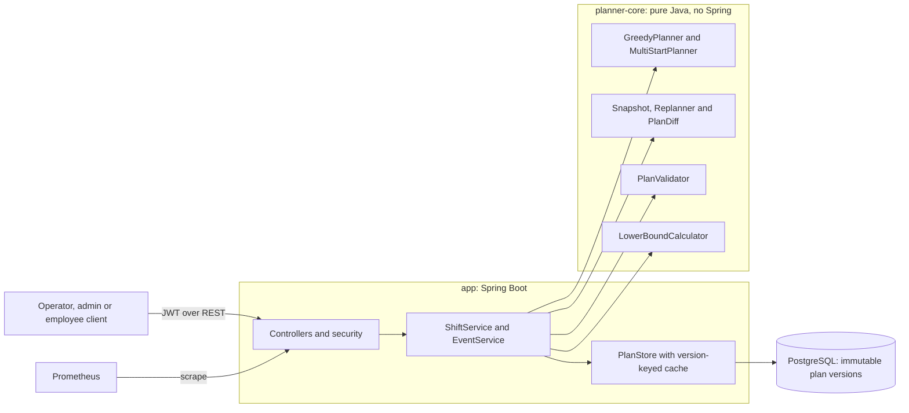
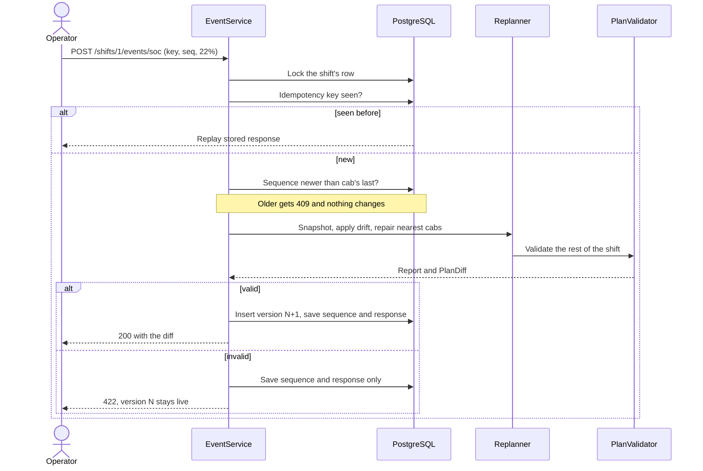

# Design

## Architecture

`planner-core` has no framework dependency, so the algorithm can be tested and run without a server or database.
The validator shares only the scenario's physics rules with the planner, and recomputes every plan from scratch.

## Planning

**Heuristic:** greedy insertion. Trips go in start-time order, and each is offered to every cab, directly or after a
charging stop at one of its two nearest hubs. The lowest score wins; the score is empty km plus charging cost, idle
time and a low-charge penalty, all in km-equivalents. A cab accepts a trip only if it can still reach a charger
afterwards in worst-case traffic, so no later step can strand it. 16 configurations of the scoring weights run in
parallel, and the plan with the fewest backup trips, then the lowest cost including the overnight refill, wins.

**Complexity:** O(T log T + T x V x (1 + H x C x log S)) time per greedy run and O(V + T + S) memory, for T trips,
V cabs, H hubs tried, C chargers per hub and S bookings per charger. The charging branch only runs for cabs that
need it, so it behaves close to O(T x V) in practice (measured in `BENCHMARK.md`). Multi-start multiplies that by 16 and divides by the cores.

**Optimality:** a Hopcroft-Karp matching over "this cab or trip can reach that next trip in time" gives the minimum
backup trips in any plan. That bound is sound because the traffic model is FIFO: leaving later never arrives earlier,
so waiting or splitting a drive cannot reach a pickup sooner. The gap is reported on every plan. Charging cost has
no useful lower bound here: cabs start with enough total charge that no trip strictly requires charging.

## Drift re-plan

A snapshot turns finished activities into history and starts each cab from where it really is. Activities in
progress stay, because they cannot be undone. The same validator can then check the rest of the shift.

Only the affected cabs and the 10 nearest are re-planned, or 40 if a trip would otherwise be lost and time remains.
Every moved trip is a driver to call, so three rules keep the change small: a trip stays with its cab whenever that
cab can still do it, a cab whose situation did not change keeps its exact steps, and a trip that must move prefers a
cab that can still do its own next trip. These rules took one demo event
from 37 moved trips to 7, and one charger failure from 67 to 0.

## Failure modes

| Failure | What happens | Evidence |
|---|---|---|
| Duplicate event | Stored response replayed, no new version | `ApiTest` |
| Out-of-order event | `409 EVENT_OUT_OF_ORDER`, no change | `ApiTest` |
| Late event from another cab | Applied at the plan's current clock, which never goes backwards; lag recorded | Designed, metric exposed |
| Concurrent events on one shift | Serialised by the row lock, also across instances | `ApiTest`, 50 events on one instance |
| Charger fails | Running session cut short, its bookings moved, plan revalidated | `ReplannerTest`, `ApiTest` |
| Repair fails validation | `422`, previous version stays live, rejection remembered | `ApiTest` |
| Planner exceeds its timeout | `503 PLANNER_TIMEOUT`, previous version stays live | `ApiTest` |
| Fresh plan requested mid-shift | `409 SHIFT_IS_LIVE`, so real events are not overwritten | `ApiTest` |
| Crash or database error during an event | Transaction rolls back, so version, sequence and response are all absent; the client retries with the same key | By design, not fault-injected |
| Cab too empty to finish its current trip | Repair rejected, old plan stays; nothing alerts dispatch yet | `ApiTest` for the rejection |

## Trade-offs

- **Consistency over availability for plan writes.** One writer per shift, in PostgreSQL. If the database is down,
  events fail with `503` instead of diverging. Reads use a cache keyed by immutable version, so they are never stale
  for a given version.
- **Latency and stability over optimality in re-planning.** A repair looks at few cabs and keeps trips in place, so it
  can leave a cheaper global plan undiscovered. The first plan is the place to optimise.
- **Greedy multi-start instead of an exact solver.** Runs in seconds and the gap is measured. In the 300-cab case
  there are at most 8 trips left to win.
- **Rule over cost at charging time.** Choosing the cheapest option per booking looked right but raised true cost by
  about 10%, because cabs came back empty for the next peak. The planner charges little at the ₹12 peak and fills up
  at cheaper rates.
- **REST with idempotency keys instead of Kafka.** Enough for one deployment and a much smaller system to run. A broker
  would be worth adding for many event sources or for replay.
- **A full plan copy per version** (about 2 MB at 300 cabs) makes audit and recovery trivial, but needs diffs or
  compaction for long retention.

## Left out

- Real road routing: distance is 1.3 x straight line, and traffic is one citywide table of time bands.
- A hard deadline inside a re-plan: the 2 s budget decides whether to widen the search, but does not stop a running
  pass. Measured latency is far below it (see `BENCHMARK.md`).
- Interrupting a timed-out planner: the client gets its answer, but the threads finish in the background.
- Real employee and fleet data: shifts come from a seeded generator.
- Multi-day planning and end-of-shift charge targets.
- Asymmetric JWT keys and key rotation.
