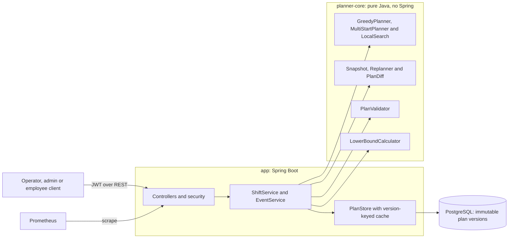
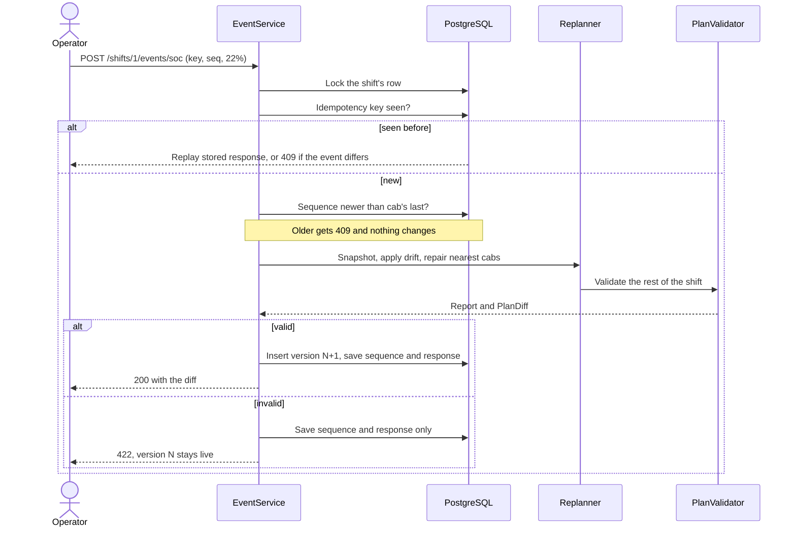

# Design

## Architecture

`planner-core` has no framework dependency, so the algorithm runs and is tested without a server or database. The
validator shares only the physics rules with the planner and recomputes every plan from scratch.

**Data model:** `tenants`; `users` (role, tenant, employee's trip); `shifts` (generator parameters, current version);
`plan_versions` (immutable JSONB state per version); `processed_events` (idempotency key, event fingerprint, stored
response); `cab_event_seq` (last sequence per cab). The tenant comes from the signed token and every lookup takes it.

**API:** `POST /auth/login`; `POST /admin/shifts`; `POST /shifts/{id}/plan`; `GET /shifts/{id}/plan/{summary, unassigned,
validate, versions, overnight}`; `GET /shifts/{id}/cabs/{cabId}/timeline`; `POST /shifts/{id}/events/soc`;
`POST /shifts/{id}/chargers/{chargerId}/failure`; `GET /me/trip`. Roles are in the README.

## Planning

**Charging curve:** two parts. Full power to 80%, then 30% of it. Power is the lower of the charger's and the car's.

**Heuristic:** greedy insertion. Trips go in start-time order, and each is offered to every cab, directly or after a
charging stop at one of its two nearest hubs. A cab accepts a trip only if it can still reach a charger afterwards in
worst-case traffic, so no later step can strand it. 16 configurations run in parallel. Local search then improves the
best plan: it clears the later work of 5 cabs near a backup trip and rebuilds it, keeping the result only if better. It
runs a fixed 5,000 steps with a fixed seed, so results repeat, and it returns the original plan if the validator refuses.

**Backups against cost:** backups always come first. Plans are compared by fewest backups, then lowest cost including the
overnight refill, so no saving can justify a lost trip at that level. Inside one greedy run, each insertion's score
mixes empty km with charging cost in km-equivalents, which can prefer a cheaper option that costs a trip later. That is
why several configurations run and the ranking above decides.

**Complexity:** O(T log T + T x V x (1 + H x C x log S)) time per greedy run and O(V + T + S) memory, for T trips, V cabs,
H hubs tried, C chargers per hub and S bookings per charger. Multi-start multiplies that by 16 and divides by the cores.
Local search adds O(N x (V + F x K x H x C x log S)) for N steps, F trips freed per step and K cabs per step. The full
search stops fitting in 30 s somewhere between 300 cabs (6.8 s) and 1,000 (59 s); `BENCHMARK.md` has the measurements.

**Optimality:** a Hopcroft-Karp matching over "this cab or trip can reach that next trip in time" gives the minimum backup
trips in any plan. It is sound because the traffic model is FIFO: leaving later never arrives earlier. It ignores
battery, so some of the reported gap may be out of reach.

## Drift re-plan

Only the affected cabs and the 10 nearest are re-planned, or 40 if a trip would otherwise be lost. Every moved trip is a
driver to call, so a trip stays with its cab whenever that cab can still do it, a cab whose situation did not change
keeps its exact steps, and a trip that must move prefers a cab that can still do its own next trip.

## Failure modes

| What fails | What the user sees | How the system recovers | Evidence |
|---|---|---|---|
| Duplicate event | Stored response, `duplicate: true` | No new version | `ApiTest` |
| Key reused for a different event | `409 IDEMPOTENCY_KEY_REUSED` | Nothing changes | `ApiTest` |
| Out-of-order event | `409 EVENT_OUT_OF_ORDER` | Nothing changes | `ApiTest` |
| Event time after the shift | `422 EVENT_TIME_AFTER_SHIFT` | Nothing recorded; retry with the right time | `ApiTest` |
| Late event from another cab | `200`, with its effective time | Applied at the plan's clock, which never goes back; lag recorded | Designed, metric only |
| Concurrent events on one shift | Each waits its turn | Row lock serialises them | `ApiTest`, 50 events on one instance |
| Crash during an event | Error or timeout | Transaction rolls back everything; retry with the same key | `FailureInjectionTest` |
| Database down | `503 DB_UNAVAILABLE` | Nothing diverges; retry when it returns | `GlobalExceptionHandlerTest` |
| Charger fails | `200` with the diff | Running session cut short, bookings moved | `ReplannerTest`, `ApiTest` |
| Cab too empty to finish, or still under the floor after charging | `200`, `strandedCab` set | Cab leaves service, its trip goes to backup, later trips move; metric and log alert dispatch | `ReplannerTest`, `ApiTest` |
| Repair fails validation | `422` | Previous version stays live; rejection remembered | `FailureInjectionTest` |
| Planner exceeds its timeout | `503 PLANNER_TIMEOUT` | Previous version stays live | `ApiTest` |
| Fresh plan requested mid-shift | `409 SHIFT_IS_LIVE` | Real events are not overwritten | `ApiTest` |

## Trade-offs

- **Consistency over availability for plan writes.** One writer per shift, in PostgreSQL. If the database is down, events
  fail instead of diverging.
- **Latency and stability over optimality in re-planning.** A repair looks at few cabs and can miss a cheaper plan.
- **Heuristic over an exact solver.** It runs in seconds and the gap is measured.
- **Backups over spare time.** Plans arrive close to pickup. Traffic 10% slower than assumed would make about 420 of 1,450
  pickups late if nobody re-plans. Planning for that traffic instead costs about 26 backup trips.
- **A separate overnight schedule, not an end-of-shift limit.** Ending low is the cheap choice while cabs can refill at
  ₹5, and `OvernightCharging` shows the refill fits.
- **REST with idempotency keys instead of Kafka.** Enough for one deployment and much smaller to run.
- **A full plan copy per version** (about 2 MB) makes audit and recovery trivial, but limits a shift to about 18 events/s.

## Left out

- Real road routing and zone speeds: one citywide table of estimated speeds. `BENCHMARK.md` measures the dependence.
- Real fleet data: shifts come from a seeded generator, so testing other seeds says nothing about real demand.
- Delay events: drift events report charge, so a cab running late does not trigger a re-plan.
- Bringing a stranded cab back into service during the shift.
- A hard deadline inside a re-plan, and stopping a timed-out planner: measured latency is far below the budget.
- A fallback for a rejected charger failure: the repair only shortens or moves sessions, so it should not fail. If it did,
  the charger would stay marked as working, with the `422` and `validator.failures` showing it.
- Checking event times within the shift: a mistyped future time before the shift ends still moves the clock.
- Multi-day planning, asymmetric JWT keys, key rotation and token revocation.
